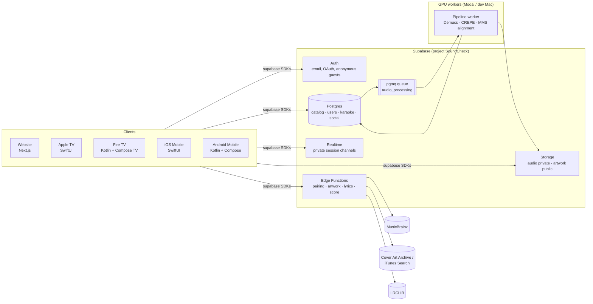
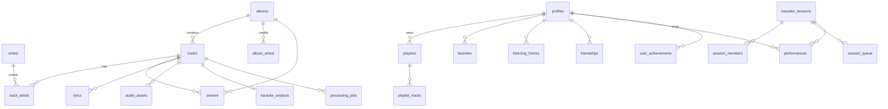

# Phase 3: SoundCheck Architecture

## System overview



All five apps talk to one Supabase project through official SDKs:
- `supabase-js` (web)
- `supabase-swift` (tvOS, iOS)
- `supabase-kt` (Fire TV, Android)

There is no separate custom API server. Business rules live in **Postgres (RLS + RPC functions)** and **Edge Functions**. Heavy audio work runs in **GPU workers** that consume a **pgmq** queue.

## Monorepo layout

```
apps/
  web/                 Next.js website (also hosts /join, the browser microphone for phones without the app)
  apple/               Xcode workspace: SoundCheckTV (tvOS) + SoundCheckMobile (iOS)
    SoundCheckKit/     Swift package shared by both: models, Supabase client, playback engine, lyric timing, scoring HUD
  android/             Gradle: :core (models, Supabase, timing, scoring HUD), :tv (Fire TV), :mobile (phones)
packages/
  contracts/           Realtime protocol + golden test fixtures shared by TS/Swift/Kotlin
  scoring/             SoundCheck Score engine (TypeScript); runs in the web app and in the score Edge Function
supabase/
  migrations/          Schema, RLS, RPCs (the source of truth for data)
  functions/           Edge Functions (Deno)
  tests/               pgTAP database tests
services/
  pipeline/            Python GPU worker (separation, melody, alignment)
  catalog/             MusicBrainz import, plus sync of the ranked subset into Supabase
docs/                  This documentation
```

## Provider abstraction

Every external source sits behind one of these interfaces. The TypeScript versions live in the web app and Edge Functions; the Python versions in the worker.

| Interface | Methods | Implementations |
|---|---|---|
| `CatalogProvider` | `searchTracks`, `getTrack`, `getArtist`, `getAlbum` | `SupabaseCatalog` (imported subset), `MusicBrainzLive` (long tail; results are upserted) |
| `ArtworkProvider` | `find(entity) → Candidate[]` | `CoverArtArchive`, `ITunesSearch`, `SpotifyOEmbed` (user-supplied link), `CovManualPicker` (web UI only) |
| `LyricsProvider` | `find(track) → Lyrics` | `LRCLIB`; `Musixmatch` (stub, needs a license) |
| `AudioSourceProvider` | `resolve(track, user) → AudioAsset[]` | `UserUpload` (Storage), `ITunesPreview` (30 s, listen-only), `LicensedKaraoke` (stub) |
| `SeparationModel` (worker) | `separate(audio) → stems` | `HTDemucs`, `RoFormer` (flagged) |

A **track exists in the catalog independently of audio**. `audio_assets` rows attach playable sources to a track. The UI shows *Play* or *Sing* only when an asset the user can access exists, and otherwise offers *Upload your copy* or *Add to wishlist*.

## Data model (summary; full DDL in `supabase/migrations`)



- **Catalog** (`artists`, `albums`, `tracks`, joins, `artwork`, `lyrics`): readable by everyone. Writes come only from the service role (import, Edge Functions, worker).
- **Audio** (`audio_assets`): rows have an `owner_id` (personal upload) or `null` (licensed, shared). RLS lets you read your own or shared rows. Files live in the private `audio` bucket under `<owner>/<track>/<kind>.m4a`, delivered via signed URLs.
- **Users:** `profiles` (1:1 with `auth.users`, created by trigger), `user_preferences`, `playlists`, `favorites`, `listening_history`, `search_history`, `friendships`. Each is owner-scoped with RLS; public playlists are readable by all.
- **Karaoke:**
  - `karaoke_sessions` has a 6-character pairing code and an expiry.
  - `session_members` covers host, singers and devices; a **guest is a Supabase anonymous user**, so RLS still has an `auth.uid()`.
  - `session_queue` and `performances` hold the score breakdown + JSON details.
- **Social:** `achievements` / `user_achievements`, plus leaderboard views:
  - global: best score per user per track;
  - friends: filtered by accepted friendships.

## Karaoke session flow (SoundCheck Stage + Party)

```mermaid
sequenceDiagram
  participant TV as TV / Web host
  participant DB as Supabase (RPC + RLS)
  participant RT as Realtime channel session:{id}
  participant P as Phone (app or /join)

  TV->>DB: rpc create_session() → {id, code}
  TV->>TV: show QR (soundcheck.app/join?code=ABC123) + code
  P->>DB: anonymous or user sign-in
  P->>DB: rpc join_session(code, display_name) → member row
  P->>RT: subscribe (private; RLS checks membership)
  TV->>RT: subscribe, sees presence {member, mic: ready}
  P->>P: calibration (noise floor, latency ping)
  TV->>RT: transport {state: playing, songPos, wallClock}
  loop every 100 ms
    P->>RT: pitch {member, frames[t,f0,conf,rms]×10}
  end
  TV->>TV: live HUD (current note hit/miss, per-singer)
  TV->>DB: song ends → edge fn score-performance(frames, reference)
  DB-->>TV: performance row (score, breakdown)
  TV->>RT: results → phones show their score
```

Realtime authorization uses **private channels** with RLS on `realtime.messages`: only members of the session can join or send.

## Audio pipeline

1. **Ingest:** a user uploads to `audio/<uid>/uploads/…`, or a licensed provider supplies a file. The client calls `rpc request_processing(track_id, asset_id)`, which inserts a `processing_jobs` row and enqueues a pgmq message.
2. The **worker** (Modal GPU, or the Mac in dev) reads from `pgmq` and downloads to a temp directory. It then runs, in order:
   - separation (`htdemucs_ft`);
   - CREPE melody → notes + phrases;
   - LRCLIB lookup;
   - MMS forced alignment → word timings;
   - key/tempo/vocal range.
3. It encodes AAC 256k / Opus, uploads stems to Storage, writes `karaoke_analysis` and `lyrics` rows, and marks the job `done`. Temp files are deleted.
4. Results are cached per **track + audio fingerprint** (Chromaprint), so the same recording is never processed twice.

## Playback engines

| Platform | Original | Karaoke (instrumental + guide vocal) | Key change |
|---|---|---|---|
| Web | `<audio>` + Media Session | Web Audio: 2 decoded buffers → gain nodes → AudioWorklet stretcher | signalsmith-stretch (WASM) |
| tvOS / iOS | AVPlayer | AVAudioEngine: 2 `AVAudioPlayerNode`s scheduled on a shared host time → mixer → `AVAudioUnitTimePitch` | TimePitch (cents) |
| Fire TV / Android | Media3 ExoPlayer | 2 ExoPlayers sharing a clock, drift-corrected every 500 ms (Phase 2: a custom `AudioProcessor` mix in one player) | `PlaybackParameters(pitch)` |

## Security
- Supabase advisors: 0 findings locally. In the cloud, 3 accepted WARNs (`authenticated_security_definer_function_executable`) for `create_session`, `join_session` and `request_processing`. They must be SECURITY DEFINER: joining by code reads a session the caller isn't yet a member of. Each one validates `auth.uid()`, and the abuse cases are covered by pgTAP tests.
- Column-level UPDATE grants (migration 7) stop privilege escalation through allowed rows. For example, a guest can't clear `is_guest` and a member can't set `role = 'host'`.
- RLS is on every table. No `service_role` key ships in any client: clients use only the **publishable key** plus the user's JWT.
- The secret key exists only in Edge Function secrets and the worker's environment.
- Pairing codes:
  - expire after 12 h;
  - are rate-limited in `join_session`;
  - the host can kick members.
- Signed audio URLs are short-lived (1 h).
